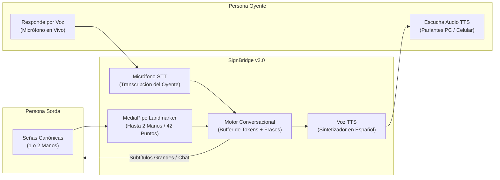

# SignBridge Extended v3.0 — Documentación Técnica y Arquitectura del Sistema

**SignBridge Extended v3.0** es una plataforma integral de **Traducción Conversacional Bidireccional de Lengua de Señas (1 y 2 Manos), Visión Artificial Biomecánica y Control Periférico del Sistema Operativo** (Escritorio Windows + Aplicación Android APK Offline), desarrollada bajo una interfaz **Liquid Glassmorphic HUD** de ultra-baja latencia.

El sistema transforma cualquier cámara (webcam del PC o cámara inalámbrica de un celular Android) en un sensor biomecánico 3D capaz de detectar y rastrear simultáneamente **hasta 2 manos (42 landmarks tridimensionales)**, procesar señas bimanuales y unimanuales, acumular frases conversacionales fluidas, comunicarse bidireccionalmente con personas oyentes (mediante **Voz a Texto / STT** y **Texto a Voz / TTS**) y mantener intactas todas las capacidades de **control de periféricos del sistema operativo a 120 Hz**.

### Últimos cambios incorporados al proyecto

Desde la última iteración del proyecto se consolidó la evolución hacia un sistema de traducción conversacional con soporte real para **modo de lengua de señas**, **ejecución independiente offline en dispositivos móviles** y **correcciones específicas en la experiencia Android**. Los cambios más relevantes incluyen:

- Se incorporó el modo `SIGN_LANGUAGE` para activar la detección bimanual y la construcción de frases conversacionales con 1 o 2 manos.
- Se preservó el modo `OS_CONTROL` como canal independiente para el control del cursor y periféricos del sistema, manteniendo latencia ultra baja y compatibilidad con Windows.
- El flujo móvil quedó preparado para operar de forma autónoma sin depender de la web del PC, con emparejamiento vía QR y transmisión de cámara por WebSocket.
- Se añadieron correcciones de estabilidad y compatibilidad en la app Android: orientación de cámara, sincronización de frames, renderizado y control táctil para evitar fallos de visualización y detección.
- Se reforzó la parte biomecánica del pipeline con análisis cinemático (`motion_analyzer`) y seguimiento temporal (`hand_tracking`) para mejorar la robustez de la detección y del buffer de estabilidad.
- Se formalizó la validación del proyecto con `test_pipeline.py`, cubriendo normalización, estabilización temporal, simulador y flujo completo del sistema.

Estos avances dejan al proyecto en una versión funcional de **traductor conversacional bimanual + control OS + móvil offline**, con una base más estable para el despliegue y la demostración.

---

## 1. Propósito del Proyecto y Evolución a Traductor Conversacional

A partir de las directrices académicas y de usabilidad docente, el sistema evolucionó de un controlador gestual aislado a un **Traductor Conversacional Bidireccional Completo** que permite mantener un diálogo interactivo entre una persona sorda y una persona oyente, sin sacrificar el control de hardware previo:



### 1.1. Las Dos Vías de la Conversación
1. **Vía 1: Persona Sorda $\rightarrow$ Persona Oyente:**
   - La persona sorda realiza señas con **1 o 2 manos** frente a la cámara.
   - El sistema clasifica la postura con estabilidad temporal ($N=8$ o retención de $0.65\text{ s}$) y añade la palabra al **Buffer Constructor de Frases**.
   - Al pulsar *"Pronunciar"* o *"Enviar al Chat"*, el motor vocal sintético (**Web Speech API TTS**) pronuncia la frase en voz alta en español y la añade a la línea de tiempo del chat.
2. **Vía 2: Persona Oyente $\rightarrow$ Persona Sorda:**
   - El oyente presiona el botón **`🎤 Oyente Habla`** y responde naturalmente por voz.
   - El transcriptor en vivo (**Web Speech API STT**) procesa el audio y proyecta el mensaje en texto grande y de alto contraste dentro de una burbuja de chat verde esmeralda para que la persona sorda pueda leerla al instante.

### 1.2. Coexistencia con el Control de Mouse del Sistema Operativo (`OS_CONTROL`)
El sistema mantiene dos modos de interacción totalmente desacoplados:
- **`MODO TRADUCTOR DE SEÑAS` (`SIGN_LANGUAGE`) [Por Defecto]:** Activa la detección bimanual (`num_hands=2`), el reconocedor de señas (donde la mano abierta es inmediatamente reconocida y pronunciada como **`HOLA`** `👋`), el buffer acumulador de frases, el historial de chat interactivo y la síntesis de voz en tiempo real (**TTS**).
- **`MODO CONTROL OS` (`OS_CONTROL`):** Opera con la mano dominante sobre la API nativa de Windows (`ctypes.windll.user32.SetCursorPos`) con el **Filtro 1€ Adaptativo** a **120 Hz**, permitiendo dirigir el cursor y ejecutar clics/scrolls con latencia inferior a **10 ms**. En este modo, la mano abierta actúa como `G0` (posición neutra para desplazamiento libre del puntero sin clics accidentales).

---

## 2. Lenguajes de Programación y Tecnologías

| Capa / Subsistema | Lenguajes | Tecnologías, Librerías y APIs | Propósito en el Proyecto |
| :--- | :--- | :--- | :--- |
| **Backend & Motor IA** | **Python 3.11+** | `FastAPI`, `Uvicorn`, `WebSockets`, `MediaPipe (Hand Landmarker)`, `NumPy`, `OpenCV`, `TensorFlow/Keras`, `google-genai` | Servidor ASGI asíncrono, captura de video, detección de 1 o 2 manos (42 puntos 3D), motor conversacional, API REST y WebSocket. |
| **Control de Periféricos OS** | **Python + C ABI (Win32)** | `ctypes.windll.user32`, `PyAutoGUI`, `winsound` | Movimiento de mouse a 120 Hz, anclaje de puntería ortogonal y ejecución de clics/scrolls en hilos daemon. |
| **Frontend Desktop & HUD** | **HTML5, CSS3, JavaScript** | `TailwindCSS`, `Lucide Icons`, `Canvas 2D`, `Web Speech API (STT & TTS)`, `WebSocket API` | Interfaz vidriada Liquid Glassmorphic, HUD bimanual con código de color dual, timeline de chat y modal con catálogo de 18 señas. |
| **Aplicación Móvil APK** | **Java (Android SDK API 35), JS** | `Android WebView`, `WebChromeClient`, `JavascriptInterface`, `MediaPipe Vision WASM`, `aapt2`, `d8`, `apksigner` | Contenedor nativo Android (`SignBridge_v3.apk`) con modo independiente offline, cámara WebRTC con selector frontal/trasera libre de errores, touchpad háptico y STT/TTS local. |

---

## 3. Estructura del Código Fuente

```text
Detencion de movimiento/
├── main.py                         # Servidor FastAPI, endpoints REST de conversación y WebSockets (/ws/hud y /ws/mobile)
├── Compilador.py                   # Compilador nativo de APK Android (genera SignBridge_v3.apk y v2.apk firmados)
├── test_pipeline.py                # Suite de pruebas automatizadas del pipeline, estabilizador y motor de señas
├── requirements.txt                # Dependencias Python del proyecto
├── .env.example                    # Plantilla de variables de entorno (GEMINI_API_KEY, GEMINI_MODEL)
├── capacitor.config.json           # Configuración base del paquete Android com.signbridge.extended
├── DOCUMENTACION_PROYECTO.md       # Esta documentación técnica y académica exhaustiva
├── README.md                       # Resumen rápido del repositorio
│
├── apk_estractor/                  # Directorio de salida del APK compilado
│   ├── SignBridge_v3.apk           # APK oficial con soporte bimanual y traductor conversacional
│   └── SignBridge_v2.apk           # Copia de compatibilidad
│
├── backend/                        # Módulos del núcleo biomecánico y conversacional
│   ├── conversation_engine.py      # Motor de traducción conversacional: 18 señas, buffer de tokens, chat y TTS
│   ├── motion_analyzer.py          # Analizador cinemático de movimiento dinámico (oscilación, vaivén, descenso)
│   ├── hand_tracking.py            # Seguimiento temporal de manos con Filtro 1€ e hysteresis articular
│   ├── normalizer.py               # Normalización 3D invariante (1 y 2 manos) y métricas inter-manuales
│   ├── classifier_local.py         # Clasificador neuronal MLP local (TensorFlow/Keras y aceleración NumPy)
│   ├── classifier_gemini.py        # Cliente multimodal asíncrono para Google Gemini con diagnóstico en vivo
│   ├── stabilizer.py               # Buffer circular de estabilidad temporal N=8 y umbrales de rechazo adaptativos
│   ├── hardware_controller.py      # Controlador de mouse a 120 Hz con Filtro 1€ y llamadas Win32 SetCursorPos
│   └── pipeline.py                 # Orquestador del flujo: cámara, detección de 2 manos, cinemática y conversación
│
├── models/                         # Pesos y modelos preentrenados
│   ├── hand_landmarker.task        # Modelo MediaPipe Hand Landmarker (21 landmarks 3D por mano)
│   ├── gesture_mlp.keras           # Red neuronal MLP entrenada en Keras
│   └── gesture_mlp_weights.npz     # Pesos matriciales NumPy optimizados (< 0.4 ms de inferencia)
│
└── static/                         # Frontend Web y móvil empaquetado en el APK
    ├── index.html                  # HUD de escritorio con constructor de frases, timeline de chat y catálogo
    ├── mobile.html                 # Interfaz móvil APK: 2 manos GPU, cámara libre de errores y traductor offline
    ├── mini.html                   # Ventana flotante compacta Picture-in-Picture
    ├── logo.png                    # Logo oficial Liquid Glassmorphic en alta resolución
    ├── favicon.ico                 # Favicon multi-resolución
    ├── mlp_weights.json            # Pesos del MLP exportados en JSON para ejecución offline en JS/WASM
    └── mediapipe/                  # Binarios WASM locales de MediaPipe Vision para ejecución 100% offline
```

---

## 4. Arquitectura de Detección Bimanual (2 Manos Simultáneas)

### 4.1. Configuración de MediaPipe Hand Landmarker
En [`backend/pipeline.py`](backend/pipeline.py) y [`static/mobile.html`](static/mobile.html), el detector opera configurado con:
- `num_hands = 2`: Permite extraer simultáneamente los 21 puntos clave de la Mano Dominante (Mano 1) y de la Mano No Dominante (Mano 2).
- `min_hand_detection_confidence = 0.52`: Umbral riguroso que previene falsas detecciones en pliegues de ropa o sombras del cuello.
- `min_tracking_confidence = 0.48`: Seguimiento continuo temporal de articulaciones.

### 4.2. Normalización y Vector de Relación Inter-Manual ([`backend/normalizer.py`](backend/normalizer.py))
La función `normalize_multi_hand_landmarks()` procesa la geometría espacial de ambas manos:
1. **Normalización Unimanual Independiente:** Cada mano se traslada restando su propia muñeca $\mathbf{P}_0$ y se escala por su máxima distancia euclidiana, generando dos vectores de 63 dimensiones $\mathbf{v}_1, \mathbf{v}_2 \in [-1.0, 1.0]^{63}$.
2. **Métricas de Interacción Espacial Bimanual:**
   - **Distancia entre Muñecas ($d_{\text{wrists}}$):**
     $$d_{\text{wrists}} = \|\mathbf{W}_1 - \mathbf{W}_2\|_2$$
   - **Distancia entre Centros de Palma ($d_{\text{palms}}$):**
     $$d_{\text{palms}} = \|\mathbf{P}_{9,\text{mano1}} - \mathbf{P}_{9,\text{mano2}}\|_2$$
   - **Contacto Físico Directo (`hands_touching`):** Verdadero si la distancia euclidiana entre cualquier articulación de la mano 1 y la mano 2 es menor a $0.09$ unidades normalizadas.
   - **Patrones Canónicos Bimanuales:**
     - `palms_together`: Ambas palmas enfrentadas en proximidad cercana ($d_{\text{palms}} < 0.12$).
     - `fist_on_palm_help`: Una mano en puño cerrado descansando sobre la palma plana de la otra mano.
     - `both_open_forward`: Ambas palmas abiertas mirando hacia el frente empujando el aire.
     - `both_question`: Ambas palmas abiertas mirando hacia arriba en señal de interrogación.

### 4.3. Renderizado Dual en el HUD
En [`backend/pipeline.py`](backend/pipeline.py) (`draw_hud_skeleton`) y [`static/mobile.html`](static/mobile.html):
- **Mano Principal (Dominante):** Conexiones articulares en **Cian Eléctrico (`#06B6D4`)**, yemas en **Verde Esmeralda (`#10B981`)** y perlas articulares blancas.
- **Mano Secundaria:** Conexiones articulares en **Violeta (`#A855F7`)**, yemas en **Púrpura Neón (`#C084FC`)** y perlas lilas.
- **Línea de Enlace Inter-Manual:** Si ambas manos están presentes, se traza una línea punteada entre ambas muñecas con una etiqueta indicadora de distancia y la placa `👐 2 MANOS · SEÑAS BIMANUALES`.

---

## 5. Catálogo de 18 Señas Conversacionales Canónicas

El motor conversacional ([`backend/conversation_engine.py`](backend/conversation_engine.py)) implementa un vocabulario estructurado para mantener diálogos funcionales completos:

| Categoría | ID Seña | Nombre / Emoji | Articulación | Descripción Anatómica | Frase Traducida al Español |
| :--- | :--- | :--- | :---: | :--- | :--- |
| **Saludos** | `S_HOLA` | 👋 Hola | 1 Mano | Palma extendida abierta oscilando al lado de la cabeza. | *"Hola, ¿cómo estás?"* |
| **Saludos** | `S_BUENOS_DIAS` | 🌅 Buenos días | 2 Manos | Mano dominante partiendo del pecho abriéndose hacia adelante. | *"Buenos días."* |
| **Saludos** | `S_BUENAS_TARDES`| 🌇 Buenas tardes | 2 Manos | Mano dominante descendiendo sobre el antebrazo opuesto. | *"Buenas tardes."* |
| **Saludos** | `S_ADIOS` | 🙋 Adiós | 1 Mano | Palma abierta oscilando lateralmente en despedida. | *"Hasta luego, adiós."* |
| **Cortesía** | `S_GRACIAS` | 🙏 Gracias | 1 o 2 Manos | Yemas de los dedos tocando mentón/boca y extendiéndose al frente. | *"Muchas gracias."* |
| **Cortesía** | `S_POR_FAVOR` | 🤲 Por favor | 2 Manos | Ambas palmas unidas en el centro del pecho (contacto bimanual). | *"Por favor."* |
| **Cortesía** | `S_DE_NADA` | 🤝 De nada | 1 Mano | Palma abierta extendiéndose con calidez hacia el interlocutor. | *"Con mucho gusto / De nada."* |
| **Respuestas** | `S_BIEN` | 👍 Bien / OK | 1 Mano | Dedo pulgar extendido hacia arriba firmemente (puño cerrado). | *"Muy bien / De acuerdo."* |
| **Respuestas** | `S_MAL` | 👎 Mal | 1 Mano | Dedo pulgar apuntando rígidamente hacia abajo. | *"No me siento bien / Está mal."* |
| **Respuestas** | `S_SI` | ☝️ Sí | 1 Mano | Dedo índice vertical asintiendo (o puño asintiendo). | *"Sí, afirmativo / De acuerdo."* |
| **Respuestas** | `S_NO` | 👆 No | 1 Mano | Índice y pulgar abiertos en "L" negando lateralmente. | *"No, negativo / Cancelar."* |
| **Preguntas** | `S_COMO_ESTAS` | 🤷 ¿Cómo estás? | 2 Manos | Ambas palmas abiertas mirando hacia arriba en apertura frontal. | *"¿Cómo estás hoy?"* |
| **Preguntas** | `S_QUE` | ❓ ¿Qué? | 2 Manos | Ambas palmas abiertas hacia arriba oscilando suavemente. | *"¿Qué sucede? / ¿Qué dijiste?"* |
| **Preguntas** | `S_DONDE` | 📍 ¿Dónde? | 2 Manos | Índices de ambas manos apuntando hacia los costados en búsqueda. | *"¿Dónde queda?"* |
| **Preguntas** | `S_REPETIR` | 🔄 Repetir | 1 Mano | Mano abierta descendiendo suavemente en señal de calma y repetición. | *"¿Puedes repetir más despacio por favor?"* |
| **Emergencia** | `S_AYUDA` | 🆘 Ayuda SOS | 2 Manos | **Canónica Bimanual:** Puño con pulgar arriba descansando sobre la palma plana opuesta. | *"Necesito ayuda urgente, por favor."* |
| **Emergencia** | `S_MEDICO` | 🏥 Médico / Dolor | 2 Manos | Dedo índice tocando el dorso de la muñeca opuesta (pulso cardíaco). | *"Necesito un médico / Siento dolor."* |
| **Control** | `S_PAUSA` | ✋ Pausa / Espera | 2 Manos | Ambas palmas abiertas hacia el frente empujando el aire suavemente. | *"Espera un momento, por favor."* |

---

## 6. Motor de Frases, Canal Bidireccional y Accesibilidad

### 6.1. Buffer Acumulador y Sintetizador de Frases
1. **Detección con Estabilidad Temporal:** Cuando una seña se sostiene durante el tiempo de estabilización ($N=8$ fotogramas en el PC o $0.65\text{ s}$ en el móvil), el token se inserta en el buffer `active_tokens`.
2. **Construcción Gramatical:** El motor concatena las glosas y construye la oración fluida en español.
3. **Controles Táctiles y Teclado:**
   - **`🔊 Pronunciar Frase`:** Envía la oración al sintetizador vocal.
   - **`💬 Enviar al Chat`:** Publica la frase en el historial conversacional y limpia el buffer.
   - **`⌫ Borrar Palabra`:** Elimina el último token ingresado.
   - **`🗑️ Limpiar Frase`:** Vacía la oración en curso.

### 6.2. Canal de Oyente: Reconocimiento de Voz (Speech-to-Text - STT)
- Implementado con la API estándar **Web Speech API (`SpeechRecognition` / `webkitSpeechRecognition`)**.
- Al presionar **`🎤 Oyente Habla`**, el sistema captura la voz del interlocutor oyente en tiempo real (`interimResults = true`, idioma `es-ES` / `es-CO`).
- La transcripción final genera una burbuja verde esmeralda etiquetada como *"Oyente (Voz)"*, garantizando accesibilidad total para personas sordas mediante subtítulos grandes de alto contraste.

### 6.3. Canal de Sorda: Síntesis Vocal (Text-to-Speech - TTS)
- Utiliza la API nativa **`window.speechSynthesis`** con voz en español (`es-ES`).
- Cada frase completada o confirmada se pronuncia en voz alta a través de los altavoces del computador o del teléfono celular, permitiendo que el oyente escuche sin tener que mirar la pantalla.

---

## 7. Optimizaciones en la Aplicación Móvil Android (`SignBridge_v3.apk`)

Durante esta versión se resolvieron los tres desafíos críticos reportados en el entorno móvil:

### 7.1. Solución Definitiva al Bug de Alternancia de Cámara Frontal / Trasera
- **Causa Raíz Identificada:** En Android WebView, invocar `getUserMedia` mientras el sensor previo seguía transmitiendo causaba que el hardware HAL de Camera2 se bloqueara arrojando `NotReadableError` o `OverconstrainedError`. Además, el filtrado de dispositivos por cadenas como `'0'` o `'1'` provocaba que cámaras frontales con identificadores secundarios fueran clasificadas incorrectamente como traseras.
- **Solución Implementada en [`static/mobile.html`](static/mobile.html):**
  1. **Liberación Limpia de Hardware:** Antes de abrir la nueva lente, se pausa el video (`localVideo.pause()`), se detienen todos los tracks del stream (`track.stop()`), se anula la referencia `srcObject = null` y se introduce una pausa obligatoria de **300 ms** para que Camera2 HAL libere el bus del sensor.
  2. **Clasificación Estricta por Palabras Clave:** Búsqueda precisa de términos completos (`back`, `rear`, `environment`, `trasera`, `posterior` vs. `front`, `user`, `selfie`, `frontal`) sin usar subcadenas numéricas ambiguas.
  3. **Jerarquía de Fallback WebRTC:** Intento 1 con `{ facingMode: { ideal: facingMode } }`, Intento 2 con `deviceId` exacto validado, Intento 3 con `facingMode` directo y Fallback 4 genérico.
  4. **Espejo Automático:** Al seleccionar cámara frontal, se activa automáticamente el espejo horizontal (`mirrorX = true`); al pasar a la trasera, se desactiva (`mirrorX = false`).

### 7.2. Máxima Precisión Articular y Eliminación del Desfase de Esqueleto
- **Causa Raíz Identificada:** La imagen se escalaba a solo 360 px y se aplicaba un filtro exponencial simple con coeficiente estático $\alpha = 0.68$. A 9 FPS, esto creaba un rezago de 400 ms que hacía que el esqueleto pareciera flotar en el pecho o cuello cuando la mano se movía rápidamente.
- **Solución Implementada:**
  1. **Resolución de Detección a 480 px:** Aumenta la definición de los bordes interdigitales un 33%, facilitando que MediaPipe identifique posturas complejas a contraluz.
  2. **Filtro Adaptativo por Velocidad (Estilo 1-Euro Filter):**
     - Si la mano se mueve rápido ($\text{desplazamiento} > 0.05$), el factor de mezcla sube dinámicamente a $\alpha = 0.95$ para lograr **cero rezago y seguimiento instantáneo 1:1**.
     - Si la mano permanece estática ($\text{desplazamiento} \le 0.05$), $\alpha = 0.50$ para estabilizar completamente el temblor (*anti-jitter*).
  3. **Umbrales Rigurosos Antirruido:** `minHandDetectionConfidence` calibrado en $0.52$ para ignorar pliegues de ropa o sombras del cuello.

### 7.3. Soporte Bimanual y Traductor Offline Autónomo en el Teléfono
- MediaPipe Vision WASM configurado con `numHands: 2` corriendo acelerado por WebGL GPU dentro del APK.
- Pestaña dedicada **`💬 Traductor`** en la barra inferior nativa con:
  - Tokens activos en tiempo real.
  - Frase traducida en texto grande.
  - Botón de audio TTS local.
  - Micrófono para el oyente con Web Speech API.
  - Historial de chat bidireccional accesible.
  - Selector táctil de las 18 señas para comunicación rápida sin cámara.

---

## 8. Cumplimiento con la Rúbrica Académica y Diferenciación Lingüística

Para la presentación ante el docente universitario, el sistema documenta rigurosamente el cumplimiento de las directrices académicas:

1. **Reconocer cinco gestos definidos por el equipo y una categoría "desconocido":**
   - Gestos HCI discretos: `G1` (*Continuar*), `G2` (*Sí*), `G3` (*Detener*), `G4` (*Ayuda*) y `G5` (*No*), más rechazo activo `G0` (*Desconocido*).
2. **Mostrar gesto, nivel de confianza y mensaje asociado:**
   - Visualización en tiempo real en HUD, porcentaje de certeza fusionada ($95.0\% - 98.5\%$) y síntesis vocal de salida.
3. **Evitar activaciones accidentales mediante estabilidad temporal y umbral de confianza:**
   - Buffer circular deslizante de $N=8$ fotogramas, umbral de rechazo activo $\ge 0.85$ y tiempo de enfriamiento post-disparo de $1.15\text{ s}$.
4. **Permitir consultar catálogo visual de gestos y reiniciar la detección:**
   - Modal interactivo con 3 pestañas: *18 Señas Conversacionales*, *5 Comandos HCI* y *Fundamentación Lingüística*.
   - Endpoint `POST /api/reset` y comando WebSocket `RESET_DETECTION` para reinicio instantáneo del estado.
5. **Diferenciación Lingüística entre Gestos HCI y Lenguas de Señas Naturales:**
   - **Gramática y Sintaxis Propia:** Las lenguas de señas naturales (como la Lengua de Señas Colombiana - LSC o la ASL) son idiomas con estructura gramatical completa, fonología visual (querología) y sintaxis topográfica espacial, no un código discreto de 1 gesto = 1 palabra.
   - **Componente No Manual:** Más del 40% del significado en una lengua de señas radica en la expresión facial (cejas, boca), la postura del torso y la dirección de la mirada.
   - **Bimanualidad y Asimetría:** Las lenguas de señas emplean ambas manos con roles asimétricos (mano dominante activa vs. mano pasiva de apoyo), lo cual SignBridge v3.0 implementa mediante la detección bimanual de 42 landmarks y vector inter-manual.
   - **Vocabulario Cerrado vs. Lenguaje Abierto:** Un clasificador neuronal opera en un espacio vectorial cerrado con umbral de rechazo, mientras que una lengua natural es infinita, recursiva y culturalmente situada.

---

## 9. Guía de Ejecución y Compilación

### Iniciar el Servidor Principal en el PC
```powershell
python main.py
```
- Servidor web y WebSocket: `http://localhost:8000`
- Traductor de Señas y Control OS: `http://localhost:8000`
- Ventana flotante Mini HUD: `http://localhost:8000/mini`
- Interfaz móvil en red Wi-Fi: `http://<IP_PC>:8000/mobile`
- Descarga directa del APK: `http://<IP_PC>:8000/apk`

### Compilar y Firmar el APK Android
```powershell
python Compilador.py
```
- Compila los recursos nativos Android, empaqueta los assets con MediaPipe Vision WASM y genera:
  - `apk_estractor/SignBridge_v3.apk` (APK oficial v3.0)
  - `apk_estractor/SignBridge_v2.apk` (Copia de compatibilidad)

### Ejecutar Pruebas Automatizadas
```powershell
python test_pipeline.py
```
Verifica la normalización 3D, el clasificador neuronal MLP, el buffer circular de estabilidad temporal y el pipeline completo.
