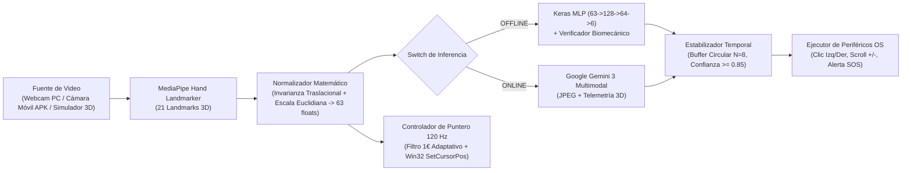

# SignBridge Extended v2.0 — Documentación Técnica y Arquitectura Completa

**SignBridge Extended v2.0** es un sistema multiplataforma de **Visión Artificial, Reconocimiento Biomecánico de Gestos Manuales y Control de Periféricos del Sistema Operativo** ( Escritorio Windows + Aplicación Nativa Android APK), diseñado bajo una interfaz **Liquid Glassmorphic HUD** de baja latencia.

El sistema transforma cualquier cámara (webcam de PC o cámara inalámbrica de un teléfono móvil Android) en un sensor espacial 3D capaz de rastrear los **21 puntos anatómicos (landmarks)** de la mano en tiempo real, clasificar intenciones gestuales mediante una arquitectura neuronal dual (**Inferencia Local Offline con TensorFlow/Keras MLP** e **Inferencia Multimodal Online con Google Gemini 3**), filtrar temblores involuntarios y ejecutar acciones físicas de mouse y sistema operativo a **120 Hz**.

---

## 1. ¿Qué hace el Proyecto? (Propósito y Capacidades)

1. **Control sin Contacto del Computador (Hands-Free HCI & Accesibilidad):**
   - Permite dirigir el cursor del mouse en Windows moviendo el dedo índice en el aire, hacer **Clic Izquierdo**, **Clic Derecho**, **Scroll Arriba**, **Scroll Abajo** y emitir **Llamadas de Asistencia Prioritaria (SOS)** sin tocar un mouse físico.
2. **Arquitectura de Inferencia Híbrida Dual (Offline vs. Online):**
   - **Modo Offline (Baja Latencia ~12 ms):** Utiliza `MediaPipe Hand Landmarker` junto con una red neuronal **Perceptrón Multicapa (MLP)** entrenada en `TensorFlow/Keras` y acelerada en `NumPy` sobre vectores geométricos normalizados de 63 dimensiones, combinada con reglas biomecánicas deterministas.
   - **Modo Online (Comprensión Contextual con Gemini 3):** Conecta de forma asíncrona no-bloqueante con el modelo multimodal **`gemini-3-flash-preview`** mediante el SDK oficial `google-genai`, enviando tanto el fotograma comprimido en JPEG como la telemetría 3D para interpretación semántica avanzada.
3. **Ecosistema Móvil Android (APK Nativa + Cámara Inalámbrica + Touchpad Háptico):**
   - Incluye una vista móvil optimizada ([`static/mobile.html`](static/mobile.html)) y un compilador automatizado ([`Compilador.py`](Compilador.py)) que empaqueta el proyecto en un archivo instalable Android ([`apk_estractor/SignBridge_v2.apk`](apk_estractor/SignBridge_v2.apk)).
   - Desde el celular se puede activar el **Modo Cámara Móvil hacia el PC** (usando la cámara frontal o trasera del teléfono como sensor principal del PC vía WebRTC + WebSockets), usar el **Touchpad Biomecánico Háptico**, disparar gestos remotos o cambiar el motor de IA del PC.
4. **Ventana Flotante Mini HUD (Picture-in-Picture):**
   - Incluye una vista compacta ([`static/mini.html`](static/mini.html)) y soporte de `Document Picture-in-Picture API` para mantener una pequeña cámara flotante siempre visible mientras se navega o controla el mouse sobre otras aplicaciones de Windows.

---

## 2. Lenguajes de Programación y Tecnologías Utilizadas

| Capa / Subsistema | Lenguajes | Frameworks, Librerías y APIs | Propósito en el Proyecto |
| :--- | :--- | :--- | :--- |
| **Backend & Motor IA** | **Python 3.11+** | `FastAPI`, `Uvicorn`, `WebSockets`, `NumPy`, `OpenCV (cv2)`, `MediaPipe`, `TensorFlow / Keras`, `google-genai`, `PyAutoGUI`, `Pillow`, `qrcode`, `python-dotenv` | Servidor asíncrono ASGI, captura y decodificación de video, extracción de 21 landmarks 3D, inferencia neuronal local y en la nube, estabilización temporal y emulación de hardware. |
| **Control Nativo de Sistema Operativo** | **Python + C ABI (Win32)** | `ctypes.windll.user32` (`SetCursorPos`), `PyAutoGUI`, `winsound` | Movimiento del puntero del mouse a **120 Hz** con **0 ms de latencia de bloqueo** mediante la API nativa de Windows (`user32.dll`) y ejecución de clics/scrolls en hilos daemon. |
| **Frontend Desktop & Mini HUD** | **HTML5, CSS3, JavaScript (ES6+)** | `TailwindCSS`, `Lucide Icons`, `Canvas 2D API`, `WebSockets API`, `WebRTC (getUserMedia)`, `Picture-in-Picture API` | Interfaz **Liquid Glassmorphic** de 3 capas de profundidad, renderizado de telemetría 3D a 60 FPS, anillo de progreso horario y gráficas de confianza. |
| **Aplicación Móvil & Empaquetado APK** | **Java (Android SDK API 35), XML, JS** | `Android WebView`, `WebChromeClient`, `JavascriptInterface`, `Vibrator API`, `aapt2`, `javac`, `d8`, `zipalign`, `apksigner`, `keytool` | Contenedor nativo Android (`com.signbridge.extended`) con permisos de cámara en tiempo de ejecución, servidor virtual HTTPS de assets, vibración háptica física y firma criptográfica v2/v3. |

---

## 3. Estructura Completa del Proyecto

```text
Detencion de movimiento/
├── main.py                         # Punto de entrada principal: Servidor FastAPI, endpoints REST y canales WebSocket (/ws/hud y /ws/mobile)
├── Compilador.py                   # Compilador automático de APK Android: genera logo, iconos mipmap, compila Java/DEX y firma el APK
├── test_pipeline.py                # Suite de pruebas automatizadas del pipeline (normalización, MLP, estabilizador y poses G0..G5)
├── requirements.txt                # Dependencias de Python del proyecto
├── .env.example                    # Plantilla de variables de entorno (GEMINI_API_KEY, GEMINI_MODEL)
├── .gitignore                      # Reglas de exclusión de Git (protección de claves .env, keystores y cachés)
├── capacitor.config.json           # Configuración base multiplataforma para el paquete com.signbridge.extended
├── instrucciones.md                # Especificación funcional y reglas de negocio del sistema
├── Desing.md                       # Sistema de diseño visual Liquid Glassmorphic (paleta, tipografía, layouts)
├── DOCUMENTACION_PROYECTO.md       # Este documento técnico detallado
│
├── apk_estractor/                  # Carpeta de salida donde Compilador.py deposita el APK compilado
│   └── SignBridge_v2.apk           # Aplicación Android compilada, alineada y firmada lista para instalar
│
├── backend/                        # Módulos del motor biomecánico e inteligencia artificial
│   ├── __init__.py
│   ├── normalizer.py               # Normalización matemática 3D (21 puntos -> 63 floats) y análisis de extensión de dedos
│   ├── classifier_local.py         # Red Neuronal MLP en TensorFlow/Keras + verificador geométrico biomecánico (G0..G5)
│   ├── classifier_gemini.py        # Cliente multimodal asíncrono para Google Gemini 3 (google-genai SDK)
│   ├── stabilizer.py               # Filtro de estabilización temporal por ventana deslizante (Buffer circular N=8)
│   ├── hardware_controller.py      # Controlador de mouse a 120 Hz con Filtro 1€ adaptativo y llamadas Win32 SetCursorPos
│   └── pipeline.py                 # Orquestador central que integra cámara local, cámara móvil, simulador 3D, IA y HUD
│
├── models/                         # Modelos de IA preentrenados y pesos locales
│   ├── hand_landmarker.task        # Modelo oficial de MediaPipe Hand Landmarker (detección de 21 articulaciones 3D)
│   ├── gesture_mlp.keras           # Modelo neuronal secuencial entrenado en TensorFlow/Keras
│   └── gesture_mlp_weights.npz     # Pesos matriciales (W1, b1, W2, b2, W3, b3) exportados para inferencia en < 1 ms
│
└── static/                         # Interfaces gráficas de usuario y recursos estáticos
    ├── index.html                  # HUD Principal de Escritorio (Liquid Glassmorphic UI)
    ├── mini.html                   # Ventana Flotante Compacta (Mini HUD para dirigir el mouse sobre otras apps)
    ├── mobile.html                 # Interfaz Móvil APK (Modo Cámara al PC, Touchpad Háptico y Control de Motor IA)
    ├── logo.png                    # Logo oficial de alta definición (512x512 RGBA) generado por Compilador.py
    ├── favicon.ico                 # Favicon multi-resolución (16x16 a 64x64) para navegadores
    └── manifest.json               # Manifiesto PWA / Web App instalable
```

---

## 4. Modelos de Inteligencia Artificial Utilizados

### 4.1. MediaPipe Hand Landmarker (`models/hand_landmarker.task`)
- **Función:** Extracción de esqueleto anatómico 3D de la mano a partir de imágenes RGB.
- **Salida:** 21 puntos clave tridimensionales $(x_i, y_i, z_i)$ normalizados respecto al cuadro de imagen:
  - `0`: Muñeca (`WRIST`)
  - `1..4`: Pulgar (`CMC`, `MCP`, `IP`, `TIP`)
  - `5..8`: Índice (`MCP`, `PIP`, `DIP`, `TIP`)
  - `9..12`: Medio (`MCP`, `PIP`, `DIP`, `TIP`)
  - `13..16`: Anular (`MCP`, `PIP`, `DIP`, `TIP`)
  - `17..20`: Meñique (`MCP`, `PIP`, `DIP`, `TIP`)

### 4.2. Red Neuronal Perceptrón Multicapa — `TensorFlow / Keras MLP` (`models/gesture_mlp.keras`)
- **Función:** Clasificación local ultrarrápida (Modo `OFFLINE`) de la postura 3D en una de las 6 clases (`G0` a `G5`).
- **Arquitectura de la Red ([`backend/classifier_local.py`](backend/classifier_local.py)):**
  - **Capa de Entrada:** Vector denso de `63` números en coma flotante (`float32`), correspondiente a las coordenadas $(x', y', z')$ normalizadas de los 21 puntos.
  - **Capa Oculta 1:** `Dense(128, activation='relu')` — proyecta las relaciones angulares entre falanges.
  - **Capa Oculta 2:** `Dense(64, activation='relu')` — comprime las combinaciones de extensión/flexión de los 5 dedos.
  - **Capa de Salida:** `Dense(6, activation='softmax')` — entrega la distribución de probabilidad $P(G_k \mid \mathbf{v})$ para $k \in \{0,1,2,3,4,5\}$.
- **Aceleración NumPy (`models/gesture_mlp_weights.npz`):**
  - Una vez entrenado el modelo en Keras con aumento de datos sintéticos (rotaciones 2D en $[-18^\circ, +18^\circ]$ y ruido gaussiano anatómico $\sigma = 0.012$), los tensores de pesos $(\mathbf{W}_1, \mathbf{b}_1, \mathbf{W}_2, \mathbf{b}_2, \mathbf{W}_3, \mathbf{b}_3)$ se cachean en disco para ejecutar el *forward pass* matricial directamente en `NumPy` en **menos de 0.4 ms** por fotograma.

### 4.3. Google Gemini 3 Flash Preview (`gemini-3-flash-preview`)
- **Función:** Inferencia multimodal contextual en la nube (Modo `ONLINE`) implementada en [`backend/classifier_gemini.py`](backend/classifier_gemini.py).
- **Integración:** Utiliza el SDK oficial `google-genai` con salida estructurada (`response_mime_type="application/json"`) y `temperature=0.1`.
- **Ejecución Asíncrona No-Bloqueante:** Para jamás congelar el renderizado de video a 30 FPS mientras se espera la respuesta HTTP de la nube, las consultas a Gemini se despachan en un hilo secundario (`threading.Thread(target=self._async_infer, daemon=True)`) con control de concurrencia (`self._in_flight`), fusionando su diagnóstico semántico en vivo con el flujo local.

---

## 5. Métodos Matemáticos y Algoritmos del Pipeline



### 5.1. Método de Normalización Espacial Invariante ([`backend/normalizer.py`](backend/normalizer.py))
Para que el reconocimiento funcione sin importar si la mano está a 20 cm o a 1 metro de la cámara, ni en qué esquina del encuadre se ubique, [`normalize_landmarks`](backend/normalizer.py) aplica tres transformaciones matemáticas a los puntos $\mathbf{P}_i = (x_i, y_i, z_i) \in \mathbb{R}^3$ para $i \in \{0, \dots, 20\}$:

1. **Invarianza a la Traslación (Resta de la Muñeca $\mathbf{P}_0$):**
   $$\mathbf{P}'_i = \mathbf{P}_i - \mathbf{P}_0, \quad \forall i \in \{0, \dots, 20\}$$
   Con esto, la muñeca queda anclada siempre en el origen $(0, 0, 0)$.

2. **Invarianza a la Escala (Distancia Euclidiana Máxima $d_{\max}$):**
   $$d_{\max} = \max_{0 \le i \le 20} \|\mathbf{P}'_i\|_2 = \max_{0 \le i \le 20} \sqrt{(x'_i)^2 + (y'_i)^2 + (z'_i)^2}$$
   $$\hat{\mathbf{P}}_i = \frac{\mathbf{P}'_i}{\max(d_{\max}, 10^{-6})}$$

3. **Vectorización 63-D:**
   $$\mathbf{v} = \text{flatten}(\hat{\mathbf{P}}_0, \hat{\mathbf{P}}_1, \dots, \hat{\mathbf{P}}_{20}) \in [-1.0, 1.0]^{63}$$

### 5.2. Evaluación Geométrica de Extensión de Dedos ([`analyze_finger_extension`](backend/normalizer.py))
Cada dedo se evalúa comparando la distancia radial desde la muñeca hasta la punta (`TIP`) frente a sus articulaciones intermedias (`PIP` y `MCP`):
- Un dedo largo (`Índice`, `Medio`, `Anular`, `Meñique`) se declara **extendido** si:
  $$\|\hat{\mathbf{P}}_{\text{TIP}}\|_2 > 1.12 \|\hat{\mathbf{P}}_{\text{PIP}}\|_2 \quad \wedge \quad \|\hat{\mathbf{P}}_{\text{TIP}}\|_2 > 1.25 \|\hat{\mathbf{P}}_{\text{MCP}}\|_2 \quad \wedge \quad \hat{y}_{\text{TIP}} < \hat{y}_{\text{PIP}} - 0.04$$
- El **Pulgar** se declara extendido lateralmente (formando la **"L / Pistola"**) cuando su punta (`4`) se separa tanto de la base del meñique (`17`) como del nudillo base del índice (`5`):
  $$\|\hat{\mathbf{P}}_4 - \hat{\mathbf{P}}_{17}\|_2 > 1.10 \|\hat{\mathbf{P}}_3 - \hat{\mathbf{P}}_{17}\|_2 \quad \wedge \quad \|\hat{\mathbf{P}}_4 - \hat{\mathbf{P}}_5\|_2 > 0.22$$

### 5.3. Matriz de Gestos Biomecánicos (`G0` a `G5`)

| ID | Gesto Físico | Condición Anatómica (21 Landmarks) | Comando Ejecutado en el PC |
| :---: | :--- | :--- | :--- |
| **`G0`** | **Mano Abierta / Neutral** | 4 o 5 dedos extendidos (o postura ambigua). Permite mover el puntero del mouse libremente sin disparar acciones. | `NONE` (Rechazo Activo) |
| **`G1`** | **Paz / Victoria (V)** | Dedos **Índice (`8`)** y **Medio (`12`)** extendidos; anular, meñique y pulgar plegados. | `RIGHT_CLICK` (Clic Derecho) |
| **`G2`** | **Índice Vertical** | Solo dedo **Índice (`8`)** extendido arriba con el **Pulgar (`4`) guardado**. | `SCROLL_UP` (`scroll(+350)`) |
| **`G3`** | **Puño Cerrado** | Los **5 dedos plegados** hacia la palma (`0` dedos extendidos). | `SCROLL_DOWN` (`scroll(-350)`) |
| **`G4`** | **Asistencia (SOS)** | **3 dedos centrales (`8, 12, 16`)** extendidos o señal **Shaka** (Pulgar `4` + Meñique `20`). | `ASSISTANCE_CALL` (Alerta Sonora + Visual) |
| **`G5`** | **Pistola / L** | Dedo **Índice (`8`)** apuntando arriba + **Pulgar (`4`)** extendido hacia afuera formando una **"L"** (medio, anular y meñique cerrados). | `LEFT_CLICK` (Clic Izquierdo) |

### 5.4. Estabilización Temporal y Rechazo Activo ([`backend/stabilizer.py`](backend/stabilizer.py))
Para evitar falsos positivos cuando la mano cambia de una postura a otra:
1. **Umbral de Rechazo Activo (`min_confidence = 0.85`):** Toda predicción cuya confianza fusionada sea $< 0.85$ se convierte automáticamente en `G0` (`NONE`).
2. **Buffer Circular Deslizante ($N = 8$ fotogramas):** Se almacena una cola FIFO (`collections.deque(maxlen=8)`) con los últimos 8 fotogramas.
3. **Progreso del Anillo Horario (`ring_progress`):**
   $$\text{progreso} = \frac{\text{conteo}(G_{\text{actual}} \text{ en buffer})}{N}$$
   Solo cuando los $N=8$ fotogramas consecutivos coinciden en el mismo gesto ($100\%$ del anillo completado) y ha transcurrido el tiempo de enfriamiento (`cooldown = 1.15 s`), se dispara la acción de hardware y el HUD emite un pulso verde esmeralda.

### 5.5. Suavizado Adaptativo de Mouse (Filtro 1€ + Interpolador a 120 Hz en [`backend/hardware_controller.py`](backend/hardware_controller.py))
El direccionamiento del cursor con la punta del dedo índice (`Landmark [8]`) implementa cuatro mecanismos para lograr precisión quirúrgica sin rezago:
1. **Mapeo de Zona Activa Ergonómica:**
   - El rectángulo central de la cámara $x \in [0.24, 0.76]$, $y \in [0.18, 0.64]$ con ganancia `1.26` se proyecta sobre el $100\%$ de la resolución del monitor ($1920 \times 1080$), permitiendo llegar al botón Inicio de Windows en la esquina inferior izquierda sin tener que bajar el brazo fuera de la mesa.
2. **Filtro 1€ Adaptativo por Velocidad (`OneEuroFilter1D`):**
   - Calcula la velocidad instantánea de la mano $\dot{x}$ y adapta la frecuencia de corte del filtro pasa-bajos:
     $$f_c = f_{c,\min} + \beta \cdot |\dot{\hat{x}}| \quad (f_{c,\min} = 1.60\text{ Hz},\ \beta = 2.80)$$
   - Si la mano se mueve lento (apuntando a un botón), $f_c$ baja y elimina el temblor del sensor; si la mano cruza la pantalla rápido, $f_c$ sube automáticamente eliminando cualquier sensación de cursor "pegado".
3. **Anclaje de Puntería (`stabilize_aim`):**
   - Cuando el usuario extiende el pulgar para formar la **"L" (`G5` - Clic Izquierdo)**, el controlador amortigua el desplazamiento del cursor (`anchor_blend = 0.16`) para que el puntero no se mueva del botón mientras se completa el clic.
4. **Hilo Interpolador a 120 Hz + `user32.SetCursorPos`:**
   - Un hilo secundario interpola sub-frames cada `8 ms` (`120 FPS`) e invoca directamente `ctypes.windll.user32.SetCursorPos(px, py)` en el kernel de Windows sin bloqueo de E/S.

---

## 6. Método de Compilación del APK Android ([`Compilador.py`](Compilador.py))

El archivo [`Compilador.py`](Compilador.py) automatiza la construcción completa del paquete nativo Android sin depender de descargas externas de Gradle:

1. **Generación Procedural del Logo y Favicon (`generate_official_logo` y `generate_favicon_ico`):**
   - Renderiza mediante supersampling `1024x1024 -> 512x512` con `OpenCV` el logo oficial en [`static/logo.png`](static/logo.png), su versión `.ico` en [`static/favicon.ico`](static/favicon.ico) y escala automáticamente los iconos de lanzador Android (`mipmap-mdpi` `48px` hasta `mipmap-xxxhdpi` `192px`).
2. **Inyección de IP LAN Preconfigurada:**
   - Detecta la IP Wi-Fi actual del PC (`get_local_ip()`) y la inyecta en el `assets/mobile.html` empaquetado dentro del APK para conexión instantánea al abrir la app.
3. **Contenedor Nativo `MainActivity.java` con Servidor Virtual HTTPS:**
   - Intercepta peticiones hacia `https://appassets.androidplatform.net/` sirviendo los recursos empaquetados en el APK (`mobile.html`, `logo.png`, `manifest.json`). Esto garantiza que el motor Chromium de Android `WebView` opere bajo un **Contexto Seguro HTTPS (`window.isSecureContext === true`)** habilitando `navigator.mediaDevices.getUserMedia` para la cámara, mientras `MIXED_CONTENT_ALWAYS_ALLOW` y `android:usesCleartextTraffic="true"` permiten la transmisión WebSocket de baja latencia hacia `ws://<IP_PC>:8000/ws/mobile`.
4. **Pipeline de Compilación SDK (`Build-Tools 36.0.0` / `Android-35`):**
   - `aapt2 compile` & `aapt2 link`: Compila recursos XML, iconos y `AndroidManifest.xml`, y genera `R.java`.
   - `javac --release 11`: Compila `MainActivity.java` y el puente `@JavascriptInterface` (`SignBridgeNative`).
   - `d8`: Transforma el bytecode Java (`.class`) en Dalvik Executable (`classes.dex`).
   - `zipalign -p -f 4`: Alinea los límites de memoria de 4 bytes del archivo APK.
   - `apksigner sign`: Firma criptográficamente el APK con esquemas **v2 y v3** usando el almacén de claves RSA-2048 (`models/signbridge_release.keystore`) y deposita el archivo final en [`apk_estractor/SignBridge_v2.apk`](apk_estractor/SignBridge_v2.apk).

---

## 7. Guía Rápida de Ejecución

### Iniciar el Servidor y HUD en el PC
```powershell
python main.py
```
- Abre automáticamente el navegador en `http://localhost:8000`.
- Ventana flotante Mini HUD: `http://localhost:8000/mini`.
- Interfaz móvil en red local: `http://<IP_DEL_PC>:8000/mobile`.
- Descarga directa del APK por Wi-Fi: `http://<IP_DEL_PC>:8000/apk`.

### Recompilar el APK Android tras cualquier cambio
```powershell
python Compilador.py
```
- Genera el APK actualizado en [`apk_estractor/SignBridge_v2.apk`](apk_estractor/SignBridge_v2.apk) en ~3 segundos.

### Ejecutar las Pruebas Automatizadas del Pipeline
```powershell
python test_pipeline.py
```

