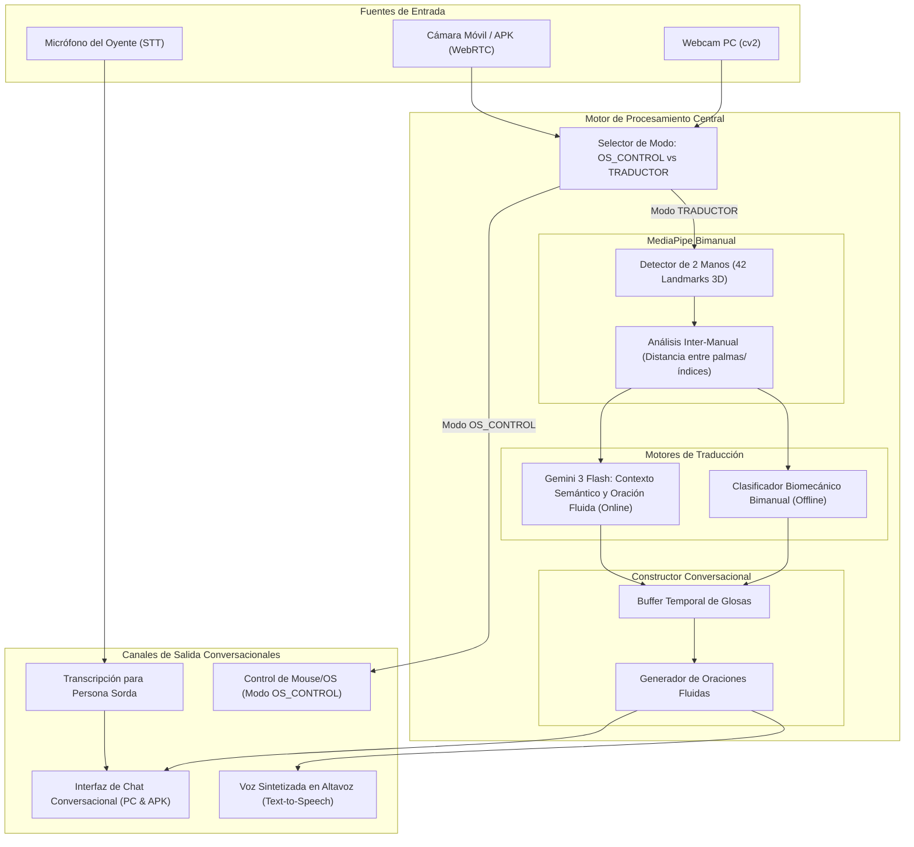

# Plan Maestro: Traductor Conversacional Bidireccional de Lenguaje de Señas
> **Proyecto:** SignBridge Extended v3.0  
> **Objetivo:** Transformar el módulo de señas en un traductor fluido para mantener conversaciones reales (2 manos, oraciones continuas, voz y texto bidireccional), conservando intactas todas las funciones de control de mouse y sistema operativo.

---

## 1. Visión y Diagnóstico de la Evolución

El feedback del profesor plantea una necesidad fundamental en accesibilidad: **un lenguaje de señas no es una lista de comandos aislados ni se ejecuta con una sola mano; es un canal de comunicación continuo y bidireccional**.

| Dimensión | Estado Actual (SignBridge v2.0) | Nuevo Traductor Conversacional (SignBridge v3.0) |
| :--- | :--- | :--- |
| **Detección de Manos** | 1 mano (21 landmarks) | **Bimanual adaptable** (1 o 2 manos: 42 landmarks 3D con relaciones inter-manuales) |
| **Propósito de Señas** | 5 alertas/mensajes individuales estáticos | **Traductor conversacional fluido** con gramática, encadenamiento de frases y vocabulario extendido |
| **Flujo de Comunicación** | Unidireccional (Persona sorda $\rightarrow$ Pantalla) | **Bidireccional completo**: Persona Sorda (Señas $\rightarrow$ Voz/Texto) $\leftrightarrow$ Oyente (Voz/Micrófono $\rightarrow$ Texto/Pantalla) |
| **Construcción de Frases** | Disparo único por gesto | **Buffer de oraciones dinámicas** (acumulación de glosas, espaciado, puntuación y suavizado sintáctico) |
| **Síntesis y Entrada de Voz** | Text-to-Speech básico offline | **TTS natural en altavoces** + **Speech-to-Text (STT)** para que el oyente responda hablando |
| **Control de Ratón / SO** | 100% operativo (1-Euro Filter, Win32) | **Preservado 100%**: Modo `OS_CONTROL` permanece ultrarrápido y aislado del traductor |

---

## 2. Arquitectura del Sistema (Mermaid)



---

## 3. Catálogo Conversacional Bimanual y Unimanual

Para sostener una conversación natural se estructura un vocabulario en **4 categorías clave**:

### A. Saludos y Cortesía Conversacional
1. **Hola / Saludo:** Mano dominante abierta oscilando lateralmente (`🖐️`).
2. **Buenos días / Tardes:** Mano dominante tocando pecho/barbilla y abriéndose hacia adelante.
3. **Gracias:** Mano plana tocando el mentón o boca y proyectándose hacia el interlocutor (`🙏`).
4. **Por favor:** Ambas manos abiertas con palmas hacia el pecho o frotándose suavemente.
5. **Mucho gusto / Encantado:** Ambas palmas abiertas cruzándose o tocándose en el centro.
6. **Adiós / Hasta luego:** Mano dominante despidiéndose en altura.

### B. Respuestas, Afirmación y Estado
7. **Sí / De acuerdo:** Puño vertical con movimiento afirmativo o gesto índice/pulgar.
8. **No / Negación:** Dedo índice oscilando en negación o índice y medio juntándose al pulgar.
9. **Bien / Excelente:** Pulgar arriba o palma abierta frontal con pulgar extendido.
10. **Mal / Regular:** Palma horizontal oscilando suavemente.
11. **Entendido / Comprendido:** Puño cerrado llevándose al pecho con pulgar arriba.

### C. Preguntas y Clarificación
12. **¿Cómo estás?:** Ambas manos sobre el pecho abriéndose hacia el oyente con expresión interrogativa.
13. **¿Qué?:** Ambas palmas abiertas mirando hacia arriba oscilando suavemente.
14. **¿Dónde?:** Índices de ambas manos apuntando hacia los lados o palmas en búsqueda.
15. **¿Puedes repetir / Despacio?:** Mano plana bajando suavemente en señal de calma.

### D. Necesidades y Asistencia Prioritaria
16. **Ayuda / Asistencia (Bimanual):** Palma no dominante como base plana horizontal; puño dominante con pulgar arriba descansando sobre ella (seña canónica de auxilio en lengua de señas).
17. **Médico / Dolor:** Dedo índice tocando dorso de muñeca o zona de dolor.
18. **Pausa / Espera un momento:** Ambas palmas abiertas hacia el frente empujando el aire.

---

## 4. El Canal Bidireccional: Oyente $\leftrightarrow$ Persona Sorda

Una conversación real exige dos direcciones:
```
[Persona Sorda]  -- (Señas con 1 o 2 manos) --> [SignBridge] --> [Texto en Pantalla + Voz TTS] --> [Oyente]
[Oyente]         -- (Voz por Micrófono)      --> [SignBridge] --> [Texto Grande + Subtítulos]  --> [Persona Sorda]
```

1. **Voz a Texto (Speech-to-Text - STT):**
   - El oyente presiona un botón de micrófono o activa modo "Escucha Activa".
   - Al hablar, su respuesta aparece en tiempo real en la pantalla en una burbuja de chat de color diferenciado (`#00F0FF` para Señas traducidas, `#10B981` para la voz del oyente).
2. **Texto a Voz (Text-to-Speech - TTS):**
   - Cada vez que la persona sorda confirma una palabra o completa una frase, el sintetizador vocal en español pronuncia la frase en voz alta por los parlantes del PC o celular.

---

## 5. Fases de Implementación Propuestas

### Fase 1: Soporte Bimanual en el Backend y Pipeline (MediaPipe 2 Manos)
- [ ] Configurar MediaPipe Hand Landmarker en `backend/pipeline.py` para detectar hasta **2 manos** (`num_hands=2`) cuando el modo sea `SIGN_LANGUAGE`.
- [ ] Mantener `num_hands=1` estricto cuando esté en `OS_CONTROL` para no saturar CPU ni desviar el puntero del mouse.
- [ ] Ampliar `backend/normalizer.py` para calcular:
  - Landmarks de Mano Izquierda (21 puntos) y Mano Derecha (21 puntos).
  - Vector de relación inter-manual (distancia entre muñecas, distancia entre puntas de dedos, orientación relativa).
- [ ] Actualizar el renderer del HUD para dibujar ambos esqueletos (cian para mano derecha, ámbar/esmeralda para mano izquierda).

### Fase 2: Motor de Inferencia y Buffer de Frases Conversacionales
- [ ] Diseñar el módulo `backend/conversation_engine.py`:
  - **Buffer acumulador de glosas/tokens:** Al sostener un gesto durante el tiempo de estabilidad (ej. 0.7s), la palabra se agrega a la oración en curso.
  - **Controles de oración:** Botones de `[Espacio]`, `[Borrar última]`, `[Pronunciar]`, `[Limpiar frase]`.
  - **Fusión semántica con Gemini (Modo Online):** Opción de enviar los tokens crudos (ej: `["HOLA", "COMO_ESTAS", "AYUDA"]`) a Gemini 3 Flash para convertirlos en una oración en español perfectamente conjugada ("Hola, ¿cómo estás? Necesito que me ayudes, por favor").
  - **Fallback Biomecánico Offline:** Reglas geométricas y red neuronal local para las 18 señas conversacionales clave sin conexión.

### Fase 3: Canal Bidireccional de Audio (STT & TTS)
- [ ] Integrar Web Speech API / SpeechRecognition en la interfaz web y APK:
  - Micrófono para el oyente con transcripción en vivo.
- [ ] Conectar SpeechSynthesis (TTS) automático al confirmar frases para emitir audio claro en español.
- [ ] Crear historial de conversación tipo chat en el HUD (burbujas estilo mensajería accesible).

### Fase 4: Adaptación del Frontend Web y APK Móvil Android
- [ ] Diseñar en `static/index.html` una pestaña o vista dedicada: **"Traductor Conversacional"**:
  - Visor de cámara con esqueleto bimanual en vivo.
  - Barra de frase en construcción con botón "Pronunciar en Voz Alta" (`🔊`) y "Borrar" (`⌫`).
  - Panel de chat bidireccional (Persona Sorda vs. Oyente).
  - Guía visual interactiva de señas conversacionales (mini-animación o ilustración de cada seña).
- [ ] Actualizar `static/mobile.html` con soporte de 2 manos en MediaPipe Vision JS y reempaquetar con `Compilador.py` en `apk_estractor/SignBridge_v3.apk`.

### Fase 5: Pruebas y Verificación Integral
- [ ] Verificar que el cambio a `OS_CONTROL` siga funcionando al 100% con latencia ultra-baja y control de mouse sin interferencias.
- [ ] Probar conversación simulada y en vivo (Persona Sorda generando frases bimanuales y oyente respondiendo por voz).
- [ ] Actualizar la documentación académica (`DOCUMENTACION_PROYECTO.md`) para que el usuario pueda presentarle la fundamentación técnica y lingüística al profesor.

---

## 6. Decisiones Clave para Alinear con el Usuario

1. **¿Prefieres que empecemos por la Fase 1 (Soporte de 2 manos en el pipeline y renderer bimanual)?**
2. **¿Deseas que el vocabulario inicial se enfoque en estas 18 señas conversacionales de cortesía/preguntas/necesidades o tienes señas específicas que tu profesor mencionó?**
